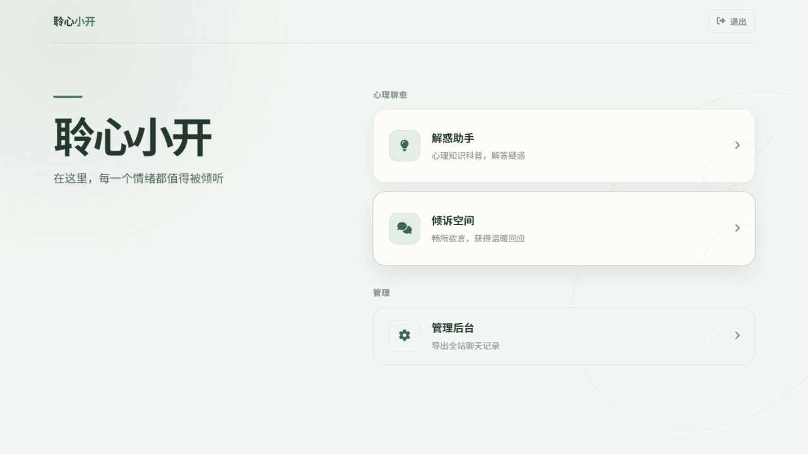
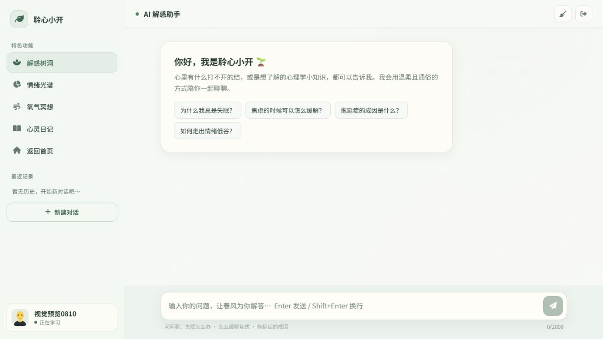
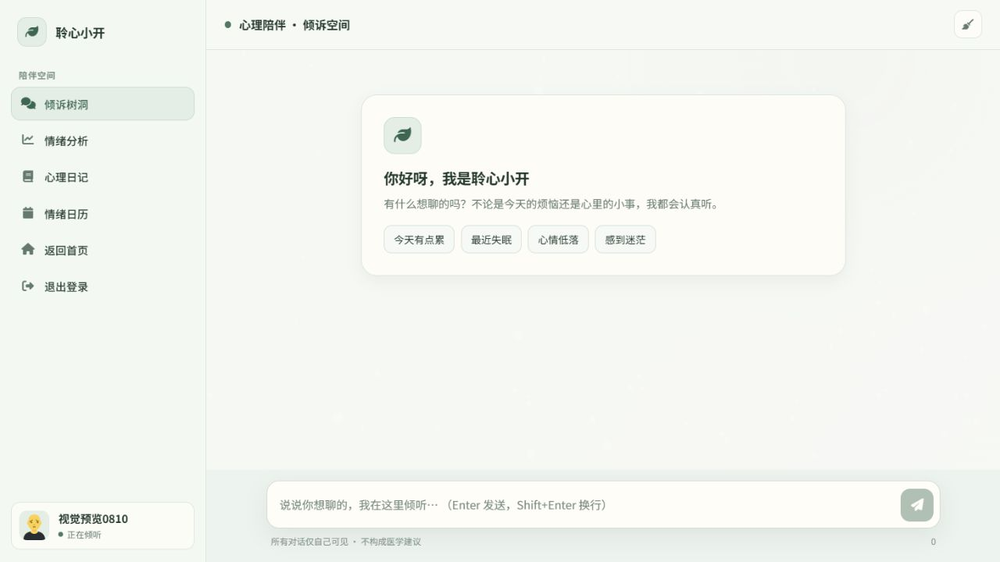
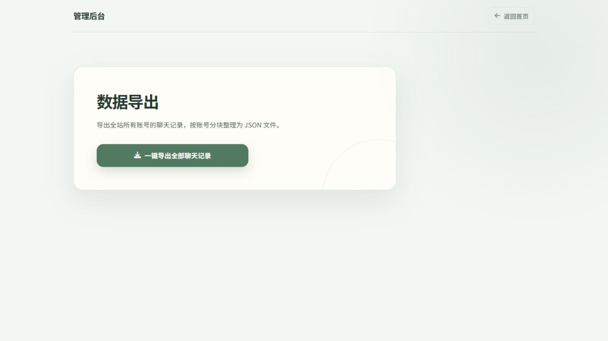
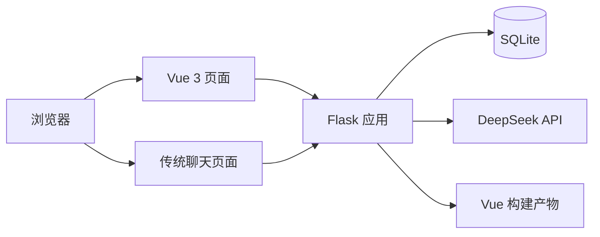

<div align="center">
  
  <h1>聆心小开</h1>
  <p>面向校园场景的心理陪伴与心理科普 Web 应用</p>
  <p>
    <a href="#项目简介">项目简介</a> ·
    <a href="#界面预览">界面预览</a> ·
    <a href="#核心功能">核心功能</a> ·
    <a href="#技术架构">技术架构</a> ·
    <a href="#快速开始">快速开始</a> ·
    <a href="#文档导航">文档导航</a>
  </p>
</div>

## 项目简介

聆心小开是一个轻量的校园心理服务应用，提供心理陪伴、心理科普、情绪分析和聊天记录管理等功能。项目采用 Flask 单体后端与 SQLite 数据库，前端由 Vue 3 页面和两个传统聊天页面共同组成，AI 能力通过服务端受控接入 DeepSeek。

项目保留了简单直接的部署方式：Vue 构建产物随仓库保存，由 Flask 统一提供页面、接口和静态资源，适合本地运行和单机部署。

## 界面预览

<table>
  <tr>
    <td align="center" width="50%">
      <strong>登录与注册</strong><br><br>
      
    </td>
    <td align="center" width="50%">
      <strong>功能首页</strong><br><br>
      
    </td>
  </tr>
  <tr>
    <td align="center" width="50%">
      <strong>心理科普</strong><br><br>
      
    </td>
    <td align="center" width="50%">
      <strong>心理陪伴</strong><br><br>
      
    </td>
  </tr>
  <tr>
    <td align="center" colspan="2">
      <strong>管理员数据导出</strong><br><br>
      
    </td>
  </tr>
</table>

## 核心功能

- **账号与会话**：学生可以使用称呼、学号和密码注册，通过 Flask Session Cookie 保持登录状态。
- **心理陪伴**：以温和、非评判的方式提供日常情绪陪伴。
- **心理科普**：以通俗、非诊断性的方式解释心理学知识。
- **流式对话**：聊天接口支持 SSE，逐段展示 AI 回复。
- **聊天记录**：按用户和会话保存历史记录，支持恢复和删除自己的会话。
- **情绪分析**：返回六维归一化情绪分数，用于前端可视化展示。
- **危机响应**：命中明确危机表达时跳过 AI 上游，返回固定干预信息。
- **管理员导出**：管理员可以在权限校验后导出用户与聊天数据。

## 技术架构



| 模块 | 技术与职责 |
| --- | --- |
| 后端 | Python 3.12、Flask 3.1.3，负责路由、Session、权限、限流和 AI 调用 |
| 数据库 | SQLite，保存用户、管理员权限和聊天消息 |
| Vue 前端 | Vue 3、Vue Router 4、TypeScript 5、Vite 8.1.5 |
| 传统页面 | 原生 HTML/CSS/JavaScript，提供心理陪伴和心理科普聊天界面 |
| AI 上游 | DeepSeek Chat Completions API，由服务端统一注入提示词和模型参数 |
| 部署 | Flask 提供完整站点；Linux 生产环境可使用 Gunicorn |

### 目录结构

```text
Lingxinxiaokai/
├─ configs/              # Gunicorn 等部署配置
├─ docs/                 # 架构、开发、接口、数据库和运维文档
├─ scripts/              # 项目启动脚本
├─ templates/            # Flask 源码、传统页面、共享资源和 Vue 构建产物
├─ tests/backend/        # Flask 接口与安全回归测试
├─ web/                  # Vue/Vite 前端源码
├─ artifacts/            # Logo 候选稿与历史素材
├─ pytest.ini            # pytest 测试发现配置
└─ README.md
```

## 快速开始

### 环境要求

- Python 3.12
- Node.js 22
- npm 10

以下命令以 Windows PowerShell 为例。

### 1. 安装后端依赖

```powershell
python -m venv templates\.venv
templates\.venv\Scripts\python.exe -m pip install -r templates\requirements.txt
```

### 2. 配置环境变量

```powershell
Copy-Item templates\.env.example templates\.env
templates\.venv\Scripts\python.exe -c "import secrets; print(secrets.token_hex(32))"
```

编辑 `templates/.env`，至少设置生成的 `SECRET_KEY` 和有效的 `DEEPSEEK_API_KEY`。完整配置项见[开发文档](docs/development.md#环境变量)。

### 3. 启动后端

```powershell
scripts\start-backend.bat
```

应用默认运行在 `http://127.0.0.1:5000`。

### 4. 启动前端开发服务器（可选）

修改 Vue 页面时，在另一个终端执行：

```powershell
Set-Location web
npm.cmd install
npm.cmd run dev
```

Vite 默认运行在 `http://localhost:5173`，并将 `/api` 代理到 Flask。

## 页面入口

| 路径 | 内容 |
| --- | --- |
| `/login` | 登录与注册 |
| `/home` | Vue 首页 |
| `/info` | 心理科普聊天页 |
| `/companion` | 心理陪伴聊天页 |
| `/admin` | 管理员数据导出页 |
| `/api/health` | 服务健康检查 |

## 开发与验证

运行后端测试：

```powershell
templates\.venv\Scripts\python.exe -m pytest -q
```

检查并构建 Vue 前端：

```powershell
Set-Location web
npx.cmd tsc --noEmit
npm.cmd run build
npm.cmd audit --audit-level=high
```

构建结果输出到 `templates/dist`。该目录由 Vite 整体生成，不应手工修改其中的哈希文件。

## 文档导航

| 文档 | 内容 |
| --- | --- |
| [文档总览](docs/README.md) | 全部项目文档的统一入口 |
| [项目架构](docs/architecture.md) | 模块关系、页面路由、认证和聊天数据流 |
| [开发说明](docs/development.md) | 环境配置、本地启动、管理员命令和开发约定 |
| [HTTP API](docs/api.md) | 请求结构、响应格式、状态码和 SSE 事件 |
| [数据库](docs/database.md) | 表结构、索引、迁移、备份和恢复 |
| [部署说明](docs/operations/deployment.md) | 前端构建、Gunicorn、HTTPS 和发布流程 |
| [故障排查](docs/operations/troubleshooting.md) | 登录、启动、构建和 AI 上游问题 |
| [安全说明](docs/security/API_SECURITY_GUIDE.md) | 权限、密钥、隐私、限流和发布检查 |
| [AI 行为参考](docs/reference/ai-behavior.md) | 服务端提示词、危机规则和修改流程 |
| [使用说明](docs/user-guide/README.md) | 注册、登录、聊天记录和功能入口 |
