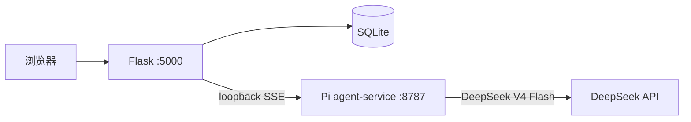

# 聆心小开

面向校园场景的本地实验性心理支持 Web 应用。它提供心理陪伴、心理科普、会话记录与非诊断性的状态回顾；不是医疗软件、正式心理咨询或正式心理测评系统。

## 当前架构



- Flask 是唯一对浏览器公开的服务，负责登录、会话隔离、SQLite 持久化、SSE 转发和状态快照查询。
- Node `agent-service` 仅监听 `127.0.0.1`，以 Pi `Agent` 和模型抽象接入 `deepseek-v4-flash`。
- 浏览器只发送本轮 `message`、`mode` 与 `session_id`；会话完整历史仅由 Flask 按已登录用户重建。
- Pi 以 token 管理上下文：保留近期原文、心理支持摘要检查点和最新状态快照，而不按 40 条消息截断。

## 功能边界

- `companion`：心理陪伴、危机预检、状态回顾。
- `popsci`：心理科普；仅能使用本地审核资料卡，不持久化状态回顾。
- 状态回顾仅呈现明确表达的情绪、关切、日常功能、保护因素、信息充分度和后续关注目标；不产生量表分数、百分比、诊断或风险灯。
- 仅有两个只读工具：`lookup_psychoeducation(topic)` 与 `get_support_resources(region)`；没有 Bash、文件、网络、数据库或任意 HTTP 工具。
- 高/紧急风险跳过普通 Agent，返回固定的 12356、110、120 与校园支持提示；不会自动联系第三方。

## 本地启动

要求：Python 3.12、Node.js 22、npm 10。

```powershell
# Python 依赖
python -m venv templates\.venv
templates\.venv\Scripts\python.exe -m pip install -r templates\requirements.txt

# Node Pi Agent 依赖
npm.cmd ci --prefix agent-service

# 配置密钥
Copy-Item templates\.env.example templates\.env
```

编辑 `templates/.env`，设置强随机 `SECRET_KEY` 与有效 `DEEPSEEK_API_KEY`。随后在两个终端依次运行：

```powershell
# 终端 1：仅本机 Pi Agent
scripts\start-agent-service.bat

# 终端 2：Flask 站点
scripts\start-backend.bat
```

打开 [http://127.0.0.1:5000](http://127.0.0.1:5000)。健康检查为 `http://127.0.0.1:8787/health` 与 `http://127.0.0.1:5000/api/health`。

## 验证

```powershell
npm.cmd test --prefix agent-service
$env:PYTHONPATH = "$PWD\templates"
templates\.venv\Scripts\python.exe -m pytest tests\backend -q
npm.cmd run build --prefix web
```

## 文档

- [Pi Agent 服务与安全边界](docs/pi-agent-service.md)
- [架构](docs/architecture.md)
- [HTTP API](docs/api.md)
- [开发与运行](docs/development.md)
- [数据库与隐私](docs/database.md)
- [AI 行为边界](docs/reference/ai-behavior.md)
