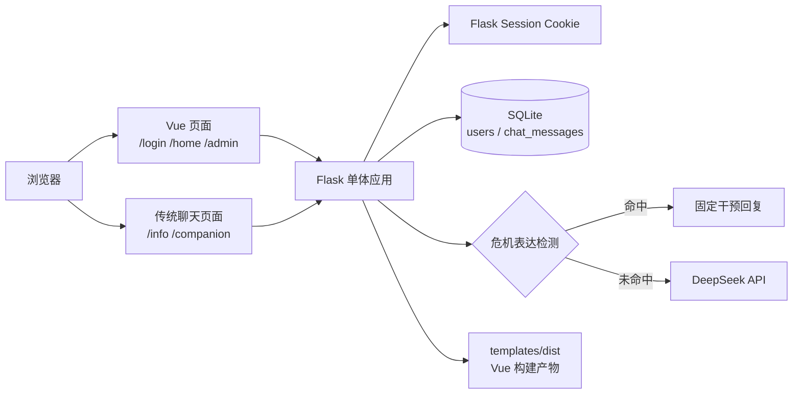

# 项目架构

## 总体结构

Flask 是唯一对外服务入口，负责页面、静态文件、认证、权限、数据库和 AI 调用。Vue 开发服务器只用于本地开发；生产环境由 Flask 提供已经构建好的 `templates/dist`。

## 运行时模块

| 文件/目录 | 职责 |
| --- | --- |
| `templates/server.py` | WSGI 和本地启动入口，暴露 `app` |
| `templates/app.py` | 应用工厂、配置、路由、Session、权限、限流和 CLI |
| `templates/db.py` | SQLite 连接、初始化、向前迁移和聊天消息对保存 |
| `templates/ai_service.py` | 服务端提示词、危机检测、DeepSeek 请求、SSE 和情绪分析 |
| `templates/assets/chat-api.js` | 两个传统聊天页共享的 Session 请求和 SSE 客户端 |
| `templates/index（心理科普）.html` | 心理科普传统页面，对应 `/info` |
| `templates/index（心理陪伴）.html` | 心理陪伴传统页面，对应 `/companion` |
| `templates/dist` | Vue 构建产物，由 Vite 生成并由 Flask 提供 |
| `web/src` | Vue 登录、首页、管理员页和路由源码 |
| `tests/backend` | 后端 API、安全和 AI 行为回归测试 |

## 页面和路由所有权

- `/login`、`/home`、`/admin` 返回同一个 Vue SPA 入口，由 Vue Router 选择页面。
- `/info`、`/companion` 由 Flask 直接返回传统 HTML，不经过 Vue Router。
- `/api/*` 全部由 Flask 处理。
- `web/vite.config.ts` 将开发环境 `/api` 代理至 `127.0.0.1:5000`，并将生产构建输出到 `templates/dist`。
- Vue 构建缺失时，Flask 对 SPA 路由返回 503 和明确的构建命令，不提供伪登录页。

## 认证与权限

认证只使用 Flask Session Cookie（默认名 `lx_session`）。登录/注册成功后，服务器在 Session 中写入 `user_id`；浏览器请求使用 `credentials: include`。项目没有 Bearer Token 登录兼容层。

公开注册始终写入 `is_admin = 0`。管理员身份只读取数据库字段，并通过 Flask CLI 在服务器本地授予或撤销。普通用户只能读取和删除自己的聊天记录；全体用户、他人聊天和全量导出需要管理员权限。

## 聊天数据流

1. 浏览器提交 `mode`、`session_id`、最近最多 20 条消息和是否流式输出。
2. Flask 校验模式、会话标识、角色、数量和内容长度；客户端不能提交 `system` 角色。
3. 最后一条用户消息先经过服务端危机关键词检测。
4. 命中危机规则时不调用 DeepSeek，直接返回固定干预内容。
5. 未命中时，`ai_service.py` 根据模式注入服务端提示词和固定模型参数，再调用 DeepSeek。
6. 成功后只把最后一条用户消息与完整助手回复作为一对写入 SQLite。
7. 流式响应使用 SSE `delta`/`error`/`done` 事件，并只发送一次 `done`。

聊天正文不写入 JSONL 或应用日志；情绪分析文本和结果不额外持久化。

## 配置加载

`templates/app.py` 会从 `templates/.env` 加载环境变量。测试通过 `create_app(test_config)` 覆盖数据库和上游配置，避免使用真实数据库或密钥。非测试启动发现占位密钥会直接失败。
