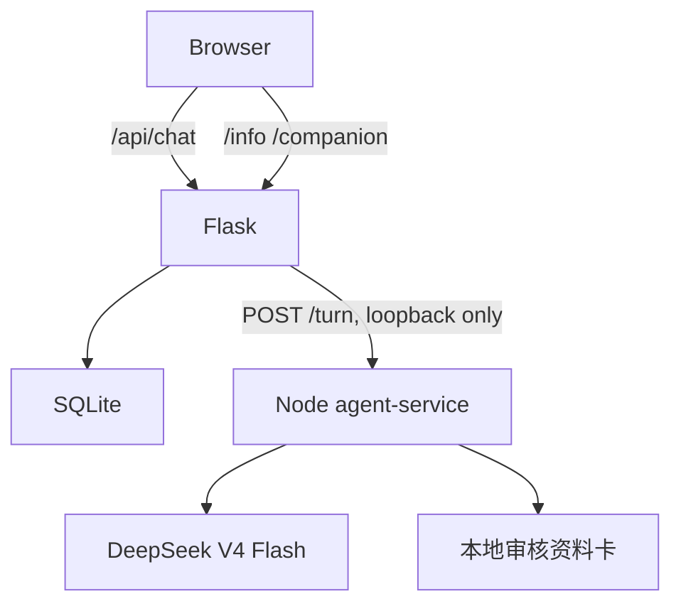

# 架构

## 职责划分

| 组件 | 职责 |
| --- | --- |
| `templates/app.py` | Flask 应用、认证、会话忙锁、公开 SSE、危机最小规则 |
| `templates/gateway.py` | 只允许 loopback 的 Node SSE 网关 |
| `templates/db.py` | SQLite schema、完整消息、状态快照、上下文检查点的原子写入 |
| `agent-service/` | Pi Agent、DeepSeek 模型组合、安全预检、本地工具、token 上下文管理 |
| `templates/index（心理陪伴）.html` | 陪伴对话与“状态回顾”界面 |
| `templates/index（心理科普）.html` | 科普对话与资料来源行 |

Flask 不持有模型 Provider 实现，也不把 API key 返回给浏览器。`AGENT_BASE_URL` 必须是 `127.0.0.1`、`localhost` 或 `::1` 的 HTTP 地址；否则应用启动时拒绝配置。

## 一轮对话

1. 浏览器仅提交模式、会话 ID、当前消息和是否流式输出。
2. Flask 以用户 ID 与会话 ID 读取完整消息、最近状态快照和检查点，并以会话忙锁防止并发写入。
3. Node 先运行确定性风险规则；非高风险时执行结构化高推理安全预检，预检只能提高风险等级。
4. 普通请求由 Pi Agent 以关闭思考的聊天模型处理；本地工具最多两批。
5. Flask 转发 `analysis`、`delta`、`error`、`done` SSE。陪伴模式在完成时原子保存回复、展示安全的状态快照和必要检查点。

高/紧急风险不会进入普通 Agent 或工具循环。完整历史不会被删除；压缩只影响送入模型的上下文。
